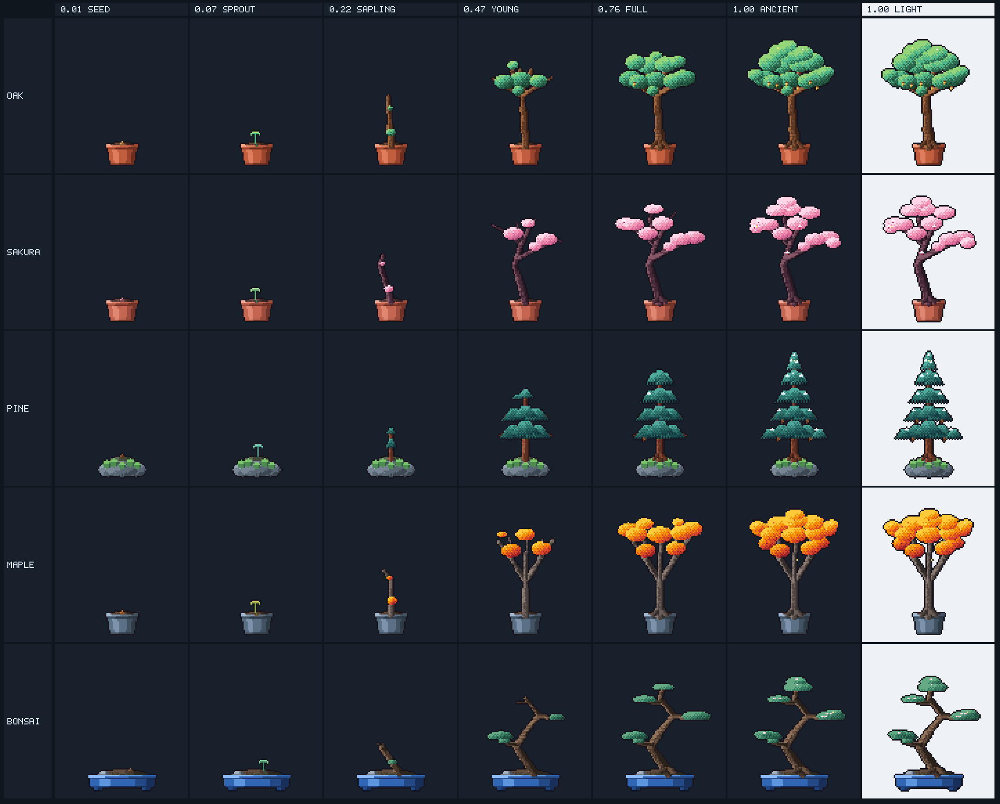

# GrowType

A cozy Windows desktop widget where every keystroke you type across any app grows a procedural pixel-art tree on your desktop.



## Features

- **5 Procedural Pixel-Art Species**:
  - **Emerald Oak** — sturdy dome canopy, golden acorns, and perched bluebird
  - **Sakura** — curved trunk, pastel pink blossoms, and drifting cherry petals
  - **Alpine Pine** — layered spruce boughs, snow-dusted tips, pinecones, and cardinal
  - **Autumn Maple** — fiery crimson and amber canopy with falling autumn leaves
  - **Zen Bonsai** — sculpted cloud pads on a cobalt ceramic tray
- **6 Continuous Growth Stages**: `Seed` → `Sprout` → `Sapling` → `Young Tree` → `Full Canopy` → `Blooming Ancient`.
- **Ambient Life & Keystroke Feedback**: Every keystroke emits rising pixel sparkles and gently rustles the canopy; mature trees attract flapping pixel butterflies, a perched songbird, and evening fireflies.
- **Transparent Floating Desktop Widget**: Frameless corner widget with integer pixel scaling (`2× / 3× / 4×`), draggable placement, smart pixel-accurate click-through on empty sky, hover progress HUD, milestone toasts, and a Windows System Tray menu (Always on Top, Ghost Mode, Pause, Launch on Startup).
- **Forest Garden & Resilient Auto-Save**: Harvest mature trees into a persistent twilight pixel meadow, inspect daily/lifetime keystroke stats, adjust growth pace (`300` / `1,500` / `5,000` keys), and rely on continuous atomic saves (`500ms` debounce + `2000ms` max wait, `.bak` recovery, and flush on quit/sleep/shutdown).

## Privacy-First Design

Global typing detection runs through a small, auditable Windows `WH_KEYBOARD_LL` helper ([`native/KeyHook.cs`](native/KeyHook.cs)) compiled locally with the built-in .NET Framework compiler (`csc.exe`):

- Pure modifier keys and held-key auto-repeats are ignored in memory.
- Virtual key codes are **never** logged, stored, or transmitted — the hook writes only `"K\n"` per keydown to `stdout`.
- No typed characters, key names, or active window titles are ever read or saved.

## Quick Start (Windows)

### Requirements
- Windows 10 / 11 with built-in `.NET Framework 4.x` (`csc.exe`)
- [Node.js](https://nodejs.org/) (v20+ recommended)

### Setup & Build
```powershell
npm install
npm run build
npm run install:shortcuts
```

### Launch
- **Without a terminal**: Double-click the **GrowType** shortcut on your **Desktop** / **Start Menu**, or run `GrowType.exe` directly.
- **From a terminal**:
  ```powershell
  npm start
  ```
- **Development mode (Vite + Electron)**:
  ```powershell
  npm run dev
  ```

## Scripts & Tests

- `npm run typecheck` — TypeScript check for renderer and Electron processes
- `npm test` — Run Vitest unit tests (`src/engine/__tests__` and `electron/__tests__`)
- `npm run build` — Compile `KeyHook.exe`, generate `tray-icon.png` / `growtype.ico`, build `GrowType.exe`, Electron main/preload, and Vite renderer
- `npm run install:shortcuts` — Create Desktop and Start Menu `.lnk` shortcuts for `GrowType.exe`
